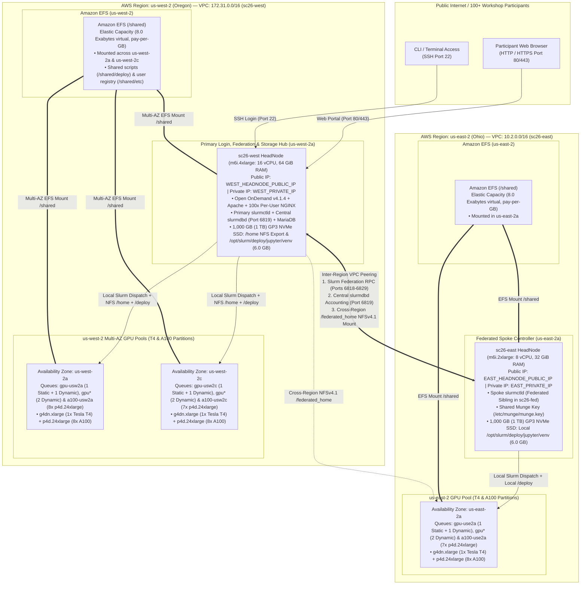
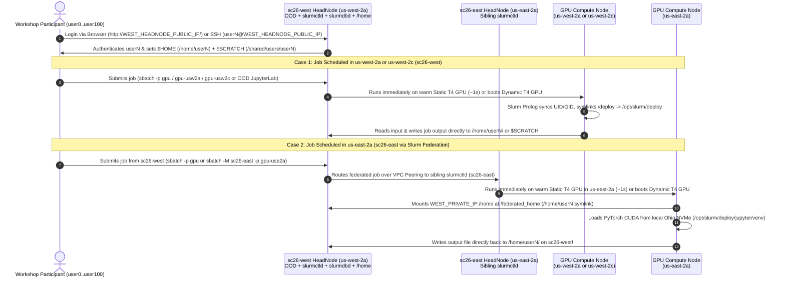

# SC26 AWS ParallelCluster + Multi-Region Slurm Federation + Open OnDemand: High-Level Architecture, Storage, Workflow & Cost Summary

## 1. Overview

This project migrates and extends the [SC25 GCP Slurm Workshop (`SC25_SUMMARY.md`)](file:///Users/fengchenliu/makabaka/SC25-NERSC/SC25_SUMMARY.md) to **Amazon Web Services (AWS)** for the **SC26 NERSC Workshop** ([`nersc-sc26`](file:///Users/fengchenliu/makabaka/SC25-NERSC/nersc-sc26)).

Unlike a single-zone cluster, the SC26 workshop GPU reservations span **multiple AWS Regions and Availability Zones (`us-west-2a`, `us-west-2c`, and `us-east-2a`)**. To give 100+ workshop participants a **single login node, a single unified `/home` directory, and transparent multi-region GPU scheduling**, this architecture combines:

- **AWS ParallelCluster v3.15.0 (RHEL 8 + Slurm 25.11.8)**: Two coordinated GPU-only clusters (`sc26-west` in Oregon `us-west-2` and `sc26-east` in Ohio `us-east-2`) configured with **3 Static (Always-Running) T4 GPU nodes** (1 per zone for instant `~1s` job startup) + **7 Dynamic (Autoscaling) T4 GPU nodes** (**10 T4 GPUs total**, adjustable anytime via [`scripts/update-gpu-scaling.sh`](file:///Users/fengchenliu/makabaka/SC25-NERSC/nersc-sc26-public/scripts/update-gpu-scaling.sh)).
- **Slurm Federation (`sc26-fed`) + Shared `slurmdbd`**: Links `sc26-west` and `sc26-east` into a single federated Slurm scheduler domain with unified Munge authentication (`munge.key`), federated queue visibility (`sinfo --federation`, `squeue --federation`), and federated job accounting (`sacct --federation`).
- **Inter-Region VPC Peering + Unified Cross-Region `/home` NFS**: Connects `us-west-2` (`172.31.0.0/16`) and `us-east-2` (`10.2.0.0/16`) over AWS backbone peering so that jobs running in **any** region (`us-west-2a`, `us-west-2c`, or `us-east-2a`) read and write directly to the participant's `/home/user<N>` directory on `sc26-west`.
- **Beefy Primary HeadNode (`m6i.4xlarge` — 16 vCPUs, 64 GiB RAM, 1,000 GB = 1 TB GP3 NVMe SSD)**: Sized to comfortably host **100+ concurrent workshop users** (`user0..user100`) across SSH and Open OnDemand Per-User NGINX (PUN) processes without ever needing a root volume resize later.
- **Open OnDemand (OOD) v4.1.4**: Zero-install browser portal offering one-click GPU **Jupyter Lab** (Batch Connect), Web Shell Terminal, Visual File Manager, Job Composer, and a federation-aware **Cluster Status** dashboard showing all **7 GPU partitions** across Oregon and Ohio.
- **Hybrid Storage Architecture (Amazon EFS `8.0 Exabyte` Elastic NFS + 2 TB GP3 NVMe SSD)**: Combines serverless, infinitely elastic **Amazon EFS (`/shared`)** for shared cluster scripts/datasets with **`1 TB` (`1,000 GB`) GP3 NVMe EBS per region (`2 TB` total across `us-west-2` and `us-east-2`)** for `/opt/slurm/deploy` and `/home`.

> [!IMPORTANT]
> All sensitive information (external IP addresses, individual user credentials, VPC/Subnet IDs, and internal host details) has been sanitized and replaced with generic placeholders (`<WEST_HEADNODE_PUBLIC_IP>`, `<EAST_HEADNODE_PUBLIC_IP>`, `<WEST_PRIVATE_IP>`, `<EAST_PRIVATE_IP>`, `user<N>`, `<WORKSHOP_PASSWORD>`) in this public summary.

---

## 2. High-Level Architecture & Storage Design



### 2.1 Architectural Component Summary (3 Static + 7 Dynamic T4 GPUs + 22 A100 Nodes)

| Component | AWS Cluster & Region/AZ | Sizing & Hardware | Role & Responsibilities |
| :--- | :--- | :--- | :--- |
| **Primary HeadNode & OOD Portal** | `sc26-west` (`us-west-2a`) | **`m6i.4xlarge`** (16 vCPUs, 64 GiB RAM, 12.5 Gbps network, **1,000 GB = 1 TB GP3 NVMe**) | Single user entry point for 100+ users; runs Open OnDemand 4.1.4, primary `slurmctld`, central `slurmdbd` + MariaDB, and exports `/home` + `/opt/slurm/deploy`. |
| **Spoke HeadNode (East Controller)** | `sc26-east` (`us-east-2a`) | **`m6i.2xlarge`** (8 vCPUs, 32 GiB RAM, **1,000 GB = 1 TB GP3 NVMe**) | Runs federated sibling `slurmctld` and `clustermgtd` to manage static & dynamic EC2 GPU nodes in `us-east-2a`; hosts local `/opt/slurm/deploy/jupyter/venv`. |
| **Oregon Zone-A GPU Queue (`gpu-usw2a`)** | `sc26-west` (`us-west-2a`) | **1 Static (`idle`) + 1 Dynamic (`idle~`)** `g4dn.xlarge` (1x Tesla T4, 16 GB)<br/>**Prod**: `p4d.24xlarge` (8x A100 40GB + EFA) | Zone-pinned queue (`MinCount: 1, MaxCount: 2`). Keeps `gpu-usw2a-st-t4usw2a-1` always warm for instant job execution plus `gpu-usw2a-dy-t4usw2a-1` on demand. |
| **Oregon Zone-C GPU Queue (`gpu-usw2c`)** | `sc26-west` (`us-west-2c`) | **1 Static (`idle`) + 1 Dynamic (`idle~`)** `g4dn.xlarge` (1x Tesla T4, 16 GB)<br/>**Prod**: `p4d.24xlarge` (8x A100 40GB + EFA) | Zone-pinned queue (`MinCount: 1, MaxCount: 2`). Keeps `gpu-usw2c-st-t4usw2c-1` always warm for instant job execution plus `gpu-usw2c-dy-t4usw2c-1` on demand. |
| **Ohio Zone-A GPU Queue (`gpu-use2a`)** | `sc26-east` (`us-east-2a`) | **1 Static (`idle`) + 1 Dynamic (`idle~`)** `g4dn.xlarge` (1x Tesla T4, 16 GB)<br/>**Prod**: `p4d.24xlarge` (8x A100 40GB + EFA) | Zone-pinned queue (`MinCount: 1, MaxCount: 2`). Keeps `gpu-use2a-st-t4use2a-1` always warm in Ohio plus `gpu-use2a-dy-t4use2a-1` on demand. |
| **Federated Overflow GPU Queue (`gpu*`)** | `sc26-west` (`us-west-2a/2c`) & `sc26-east` (`us-east-2a`) | **4 Dynamic (`idle~`)** `g4dn.xlarge` (`2` in Oregon + `2` in Ohio) | Default federated overflow pool (`MinCount: 0, MaxCount: 2` per region) that scales `0 -> 4` additional T4 GPUs on demand. |
| **Oregon Zone-A A100 Queue (`a100-usw2a`)** | `sc26-west` (`us-west-2a`) | **Up to 8x `p4d.24xlarge`** (`64x NVIDIA A100 40GB` + `4x 100 Gbps EFA`) | Pre-configured in `placeholder` mode (`MinCount: 0, MaxCount: 8`); switches to `2` static nodes on Oct 23 (`oct23` mode) and `8` static nodes on Nov 15 (`nov15` mode). |
| **Oregon Zone-C A100 Queue (`a100-usw2c`)** | `sc26-west` (`us-west-2c`) | **Up to 7x `p4d.24xlarge`** (`56x NVIDIA A100 40GB` + `4x 100 Gbps EFA`) | Pre-configured in `placeholder` mode (`MinCount: 0, MaxCount: 7`); switches to `7` static nodes on Nov 15 (`nov15` mode). |
| **Ohio Zone-A A100 Queue (`a100-use2a`)** | `sc26-east` (`us-east-2a`) | **Up to 7x `p4d.24xlarge`** (`56x NVIDIA A100 40GB` + `4x 100 Gbps EFA`) | Pre-configured in `placeholder` mode (`MinCount: 0, MaxCount: 7`); switches to `2` static nodes on Oct 23 (`oct23` mode) and `7` static nodes on Nov 15 (`nov15` mode). |
| **Amazon EFS Shared Storage** | `us-west-2` & `us-east-2` | **Elastic (`8.0 Exabytes` virtual limit)**, General Purpose, encrypted | Serverless multi-AZ NFSv4.1 filesystem mounted at `/shared` across HeadNode and compute nodes. |
| **Inter-Region VPC Peering** | `us-west-2` $\leftrightarrow$ `us-east-2` | `172.31.0.0/16` $\leftrightarrow$ `10.2.0.0/16` | Private AWS backbone link carrying Slurm Federation RPCs, `slurmdbd` accounting, and `/federated_home` NFSv4.1 traffic. |

---

### 2.2 Detailed Storage & File System Architecture (Amazon EFS vs. GP3 NVMe EBS)

A major architectural advantage of **AWS (`SC26`)** over **Google Cloud (`SC25`)** is how shared storage is provisioned, sized, and billed. Whereas GCP Filestore requires pre-allocating a minimum **1 TB (`1,024 GB`)** fixed block at ~\$204.80/month even when empty, AWS combines **serverless, infinitely elastic Amazon EFS (`/shared`)** with **high-IOPS HeadNode GP3 NVMe EBS (`1,000 GB = 1 TB` per region; `2 TB` total across `us-west-2` and `us-east-2`)**.

#### Live `df -hT` & Usage Breakdown on `sc26-west` (`m6i.4xlarge`) & `sc26-east` (`m6i.2xlarge`)
```text
Filesystem      Type   Size  Used Avail Use% Mounted on
/dev/nvme0n1p3  xfs   1000G   49G  952G   5% /          (Includes /home & /opt/slurm/deploy)
127.0.0.1:/     nfs4   8.0E    0G  8.0E   0% /shared    (Amazon EFS via local TLS stunnel proxy)
```
- **Base OS + Slurm + Open OnDemand RPMs (`/`)**: `~43 GB` used
- **Shared Python 3.11 + PyTorch 2.14.1 (`+cu130`) + JupyterLab Virtualenv (`/opt/slurm/deploy/jupyter`)**: `6.0 GB` used (100,000+ small Python/CUDA files)
- **101 Workshop User Home Directories (`/home/user0..user100`)**: **`952 GB` free** on the `1,000 GB (1 TB)` GP3 NVMe volume (~9.5 GB/user in `/home` right from day one, with no volume resize ever needed!)
- **Amazon EFS (`/shared`)**: `8.0 Exabytes` (`8,000,000,000 GB`) virtual elastic capacity (`~136 KB` currently used by `/shared/deploy` and `/shared/etc/users.list`)

#### How the 3 Shared Storage Tiers Work Together

| Mount Path | Underlying AWS Storage Technology | Capacity & Sizing | How It Is Shared Across Nodes | Why We Use It for This Specific Role |
| :--- | :--- | :--- | :--- | :--- |
| **`/shared`** *(with per-user `$SCRATCH` at `/shared/users/<user>`)* | **Amazon EFS (Elastic File System)** | **Serverless & Elastic (`0 GB` to `8.0 Exabytes`)** — No fixed size to pre-allocate! Grows and shrinks automatically as files are added or deleted (\$0.30/GB-month for actual data stored). | Mounted natively via AWS EFS Mount Helper (`nfs4` over `127.0.0.1` TLS proxy) across all AZs (`us-west-2a`, `us-west-2c`). | Hosts shared cluster config (`/shared/etc/users.list`), deployment scripts (`/shared/deploy`), shared datasets, and **isolated per-user `$SCRATCH` directories (`/shared/users/user0..user100`, `chmod 700`, `drwx------`)** so each user can only access their own large-file scratch folder. |
| **`/opt/slurm/deploy`** *(symlinked at `/deploy`)* | **HeadNode Local GP3 NVMe EBS Volume** | **Part of the `1,000 GB (1 TB)` GP3 Root Volume** (`6.0 GB` used by PyTorch + CUDA + JupyterLab; `3,000 baseline IOPS`, `250 MB/s` throughput). | AWS ParallelCluster automatically NFS-exports `/opt/slurm` to all local compute nodes; each region (`sc26-west` and `sc26-east`) has its own `1 TB` local NVMe volume. | **15x faster Python/PyTorch installs & imports**: A newly created, empty EFS filesystem in `bursting` throughput mode throttles metadata IOPS when extracting 100,000+ small `pip` files (~20 min). Putting `/deploy/jupyter/venv` on GP3 NVMe cuts `pip install torch jupyterlab` down to **~60 seconds** and gives compute nodes local-region NVMe read speed! |
| **`/home`** *(and `/federated_home`)* | **Primary HeadNode (`sc26-west`) GP3 NVMe EBS Volume** | **`952 GB` available** on the **`1,000 GB (1 TB)`** root volume (`Size: 1000` in [`config/sc26-test-gpu.yaml`](file:///Users/fengchenliu/makabaka/SC25-NERSC/nersc-sc26-public/config/sc26-test-gpu.yaml), [`config/sc26-east-gpu.yaml`](file:///Users/fengchenliu/makabaka/SC25-NERSC/nersc-sc26-public/config/sc26-east-gpu.yaml), and [`config/sc26-workshop-prod.yaml`](file:///Users/fengchenliu/makabaka/SC25-NERSC/nersc-sc26-public/config/sc26-workshop-prod.yaml)). | Exported via Kernel NFSv4.1 from `sc26-west` (`<WEST_PRIVATE_IP>:/home`) to **both** `us-west-2` (`172.31.0.0/16`) and `us-east-2` (`10.2.0.0/16` over VPC Peering at `/federated_home`). | Gives all 101 users (`user0..user100`) a **single unified `/home/user<N>` directory across both Oregon and Ohio**! When a job runs on a GPU in `us-east-2a`, its output file (`pytorch_use2a_*.out`) appears immediately in `/home/user<N>/` on `sc26-west`. |

> [!TIP]
> **Why Both `sc26-west` and `sc26-east` Start with `Size: 1000` (`1 TB`) from Day One**:
> 1. **Zero Future Resize Required (`UpdatePolicy.UNSUPPORTED`)**: AWS ParallelCluster does not allow changing `HeadNode -> LocalStorage -> RootVolume -> Size` via `pcluster update-cluster` after a cluster is created. By setting `Size: 1000` (`1 TB` in `us-west-2` and `1 TB` in `us-east-2` = **`2 TB` total**) in [`config/sc26-test-gpu.yaml`](file:///Users/fengchenliu/makabaka/SC25-NERSC/nersc-sc26-public/config/sc26-test-gpu.yaml) and [`config/sc26-east-gpu.yaml`](file:///Users/fengchenliu/makabaka/SC25-NERSC/nersc-sc26-public/config/sc26-east-gpu.yaml), both HeadNodes start with **`952 GB` of free NVMe space** (`~$2.67/day` per region) from initial creation and never need to be resized when switching into `oct23` or `nov15` A100 modes.
> 2. **To store large per-user files in `$SCRATCH` (`/shared/users/<username>`) or shared datasets in `/shared`**: No size change is needed because Amazon EFS is automatically elastic up to 8 Exabytes! Each user's `/shared/users/<username>` directory is enforced with `chmod 700` (`drwx------`) so `user1` cannot read or list `/shared/users/user2`. If 100 GPU jobs will read heavy datasets from `/shared` simultaneously, add `ThroughputMode: elastic` under `SharedStorage -> EfsSettings` in the YAML so EFS scales read throughput up to **3 GiB/s** automatically.

---

## 3. How the Federated Cluster Works Under the Hood

### A. End-to-End Participant & Multi-Region Job Lifecycle



### B. Seven Key Engineering Mechanisms

1. **Unified Munge Authentication Across Regions (`munge.key`)**:
   - AWS ParallelCluster stores a master copy of the Munge key at `/opt/parallelcluster/shared/.munge/.munge.key` and copies it to `/etc/munge/munge.key` on every compute node at boot (`aws-parallelcluster-slurm/libraries/helpers.rb`).
   - [`scripts/setup-slurm-federation.sh`](file:///Users/fengchenliu/makabaka/SC25-NERSC/nersc-sc26-public/scripts/setup-slurm-federation.sh) copies `sc26-west`'s `/etc/munge/munge.key` to **both** `/etc/munge/munge.key` and `/opt/parallelcluster/shared/.munge/.munge.key` on `sc26-east` (as well as any running compute nodes), ensuring that both HeadNodes and all static/dynamic GPU nodes in `us-west-2a`, `us-west-2c`, and `us-east-2a` trust each other's Slurm credentials.

2. **Cross-Region `/federated_home` & Isolated Per-User `$SCRATCH` (`/shared/users/<username>`)**:
   - `sc26-west` exports `/home` to both `172.31.0.0/16` (`us-west-2`) and `10.2.0.0/16` (`us-east-2`), mounted at `/federated_home` on `sc26-east` so `/home/user0..user100` are unified across regions.
   - [`setup/create-users.sh`](file:///Users/fengchenliu/makabaka/SC25-NERSC/nersc-sc26-public/setup/create-users.sh) and [`setup/compute-node-setup.sh`](file:///Users/fengchenliu/makabaka/SC25-NERSC/nersc-sc26-public/setup/compute-node-setup.sh) export `SCRATCH=/shared/users/$USER` via `/etc/profile.d/sc26-scratch.sh` and create `/shared/users/user0..user100` with **`chmod 700` (`drwx------`)** owned by `userN:userN` so each user can only access their own scratch directory.

3. **Slurm Federation + AWS ParallelCluster `clustermgtd` Compatibility**:
   - AWS ParallelCluster's `clustermgtd` daemon runs `/opt/slurm/bin/sinfo` every 60 seconds to inspect local nodes.
   - If `FederationParameters=fed_display` is set globally in `slurm.conf`, `sinfo` returns remote sibling nodes and causes `clustermgtd` to reject the output.
   - By omitting `FederationParameters=fed_display` from `slurm.conf` and instead installing `/etc/profile.d/sc26-federation.sh` (`alias sinfo="sinfo --federation"`, `alias squeue="squeue --federation"`), `clustermgtd` manages EC2 instances cleanly in both regions while interactive users automatically see the full federated cluster view.

4. **Static + Dynamic Compute Node User & Package Synchronization**:
   - [`setup/compute-node-setup.sh`](file:///Users/fengchenliu/makabaka/SC25-NERSC/nersc-sc26-public/setup/compute-node-setup.sh) is registered as a Slurm Prolog (`/opt/slurm/etc/scripts/prolog.d/90_sc26_compute_setup.sh`) and invoked during [`scripts/setup-slurm-federation.sh`](file:///Users/fengchenliu/makabaka/SC25-NERSC/nersc-sc26-public/scripts/setup-slurm-federation.sh) so every static (`idle`) and dynamically booted (`idle~`) GPU node automatically gets `/deploy` symlinked, `/federated_home` mounted, `user0..user100` UIDs/GIDs (`2000..2100`) created, and `nmap-ncat` + `python3.11` installed.

5. **Open OnDemand 4.1 `"SC26 Workshop (NERSC-AWS)"` Portal, Connect to Jupyter Button & Federated GPU Count Patch**:
   - [`setup/configure-ondemand-cluster.sh`](file:///Users/fengchenliu/makabaka/SC25-NERSC/nersc-sc26-public/setup/configure-ondemand-cluster.sh) generates `/var/www/ood/apps/sys/jupyter/manifest.yml`, `form.yml.erb`, and `view.html.erb` (providing the blue **Connect to Jupyter** button that posts `password` to `/node/<host>/<port>/login` across both `us-west-2` and `us-east-2` GPU nodes).
   - [`post/configure-ondemand-auth.sh`](file:///Users/fengchenliu/makabaka/SC25-NERSC/nersc-sc26-public/post/configure-ondemand-auth.sh) configures the **`SC26 Workshop (NERSC-AWS)`** top navbar header and registers `/shared/users/<user>` (`Scratch`) in the **Files ▾** dropdown menu.
   - `ood_core`'s `slurm.rb` (`get_cluster_info`) is patched to pass `--federation` and widen `nodehost` to `nodehost:40` so the OOD **Cluster Status** widget accurately reports all **10 GPUs** across `us-west-2a`, `us-west-2c`, and `us-east-2a`.

6. **One-Command Static & Dynamic GPU Fleet Resizing (`scripts/update-gpu-scaling.sh`)**:
   - [`scripts/update-gpu-scaling.sh`](file:///Users/fengchenliu/makabaka/SC25-NERSC/nersc-sc26-public/scripts/update-gpu-scaling.sh) allows updating the number of static (`MinCount`) and dynamic (`MaxCount - MinCount`) GPUs across both regions with a single command (`bash scripts/update-gpu-scaling.sh <STATIC_PER_ZONE> <DYNAMIC_PER_ZONE> <DYNAMIC_POOL_PER_REGION>`), defaulting to `1 1 2` (**3 Static + 7 Dynamic = 10 T4 GPUs**).

7. **Capacity Block Support & Zero-Cost Multi-NIC `p4d.24xlarge` Connectivity (`scripts/configure-a100-partitions.sh`)**:
   - AWS ParallelCluster natively supports targeting `p4d.24xlarge` Capacity Blocks (`8 × NVIDIA A100 GPUs` + `4 × 100 Gbps EFA` per node) in `us-west-2a`, `us-west-2c`, and `us-east-2a` by setting `CapacityType: CAPACITY_BLOCK` on the `a100-usw2a`, `a100-usw2c`, and `a100-use2a` queues and `CapacityReservationTarget: { CapacityReservationId: cr-xxxxx }` via [`scripts/configure-a100-partitions.sh`](file:///Users/fengchenliu/makabaka/SC25-NERSC/nersc-sc26-public/scripts/configure-a100-partitions.sh) (see Section 7 below).
   - Because `p4d.24xlarge` has 4 NetworkCards (`AssignPublicIp: false`), [`scripts/setup-multi-region-network.sh`](file:///Users/fengchenliu/makabaka/SC25-NERSC/nersc-sc26-public/scripts/setup-multi-region-network.sh) provisions **free S3 & DynamoDB Gateway VPC Endpoints** in both regions and [`post/one-shot-post.sh`](file:///Users/fengchenliu/makabaka/SC25-NERSC/nersc-sc26-public/post/one-shot-post.sh) starts a lightweight `squid` HTTP proxy (`port 3128`) on each HeadNode so `p4d.24xlarge` nodes bootstrap and install packages without needing paid NAT Gateways.

---

## 4. How Workshop Users & Organizers Access the Cluster

### Method 1: Web Browser Access via Open OnDemand (Recommended for Participants)
1. Open a browser and navigate to the `sc26-west` Primary HeadNode:
   ```text
   https://<WEST_HEADNODE_PUBLIC_IP>/
   ```
2. Log in with assigned workshop credentials:
   - **Username**: `<WORKSHOP_USERNAME>` (e.g., `user<N>`)
   - **Password**: `<WORKSHOP_PASSWORD>`
3. Use the **`SC26 Workshop (NERSC-AWS)`** top navigation bar:
   - **Interactive Apps $\rightarrow$ Jupyter Lab**: Launches a GPU-backed JupyterLab notebook on a Slurm GPU compute node (`SC26 Workshop (PyTorch + GPU)` kernel) with one-click **Connect to Jupyter** across any of the 7 partitions (`gpu`, `gpu-usw2a`, `gpu-usw2c`, `gpu-use2a`, `a100-usw2a`, `a100-usw2c`, `a100-use2a`).
   - **Clusters $\rightarrow$ SC26 Workshop Cluster Shell Access**: Opens an in-browser terminal on `sc26-west`.
   - **Files $\rightarrow$ Home Directory / Scratch (`/shared/users/user<N>`)**: Browse, edit, upload, and download files in `/home/user<N>` or isolated per-user `$SCRATCH` space (`/shared/users/user<N>`).
   - **Jobs $\rightarrow$ Active Jobs**: Monitor running and queued jobs across the federation.

### Method 2: Command-Line SSH & Slurm Federation Commands
Participants or instructors can SSH directly into the primary HeadNode:
```bash
ssh <WORKSHOP_USERNAME>@<WEST_HEADNODE_PUBLIC_IP>
```

#### Submitting GPU Jobs Across the Federated Cluster
Every user home directory comes pre-populated with `example-job.sh` and `run_pytorch_test.sh`:
```bash
# 1. Submit to the default federated 'gpu' partition (Slurm Federation schedules automatically)
sbatch -p gpu ~/run_pytorch_test.sh

# 2. Target a specific Availability Zone in Oregon (us-west-2a or us-west-2c)
sbatch -p gpu-usw2a ~/run_pytorch_test.sh
sbatch -p gpu-usw2c ~/run_pytorch_test.sh
sbatch -p a100-usw2a ~/run_pytorch_test.sh
sbatch -p a100-usw2c ~/run_pytorch_test.sh

# 3. Target Ohio (us-east-2a) directly from the Oregon login node
sbatch -M sc26-east -p gpu-use2a ~/run_pytorch_test.sh
sbatch -M sc26-east -p a100-use2a ~/run_pytorch_test.sh
```

#### Monitoring the Federated Cluster
```bash
# View all partitions and GPU node states across both us-west-2 and us-east-2
sinfo --federation

# View all running and queued jobs across both regions
squeue --federation

# View federation controller health and sibling sync state
scontrol show fed

# View completed job accounting across both regions
sacct --federation -a -X -o JobID,JobName%16,User,Cluster,Partition,NodeList%24,State,ExitCode
```

---

## 5. Verification & Testing Performed

All requirements for the multi-region, multi-AZ GPU cluster were verified live on AWS across **`us-west-2a`**, **`us-west-2c`**, and **`us-east-2a`**:

| Test Category | Description & Test Executed | Observed Result | Status |
| :--- | :--- | :--- | :--- |
| **Multi-Region VPC, Peering & Gateway Endpoints** | Automated creation of `us-east-2` VPC (`10.2.0.0/16`), Inter-Region VPC Peering with `us-west-2` (`172.31.0.0/16`), and S3/DynamoDB Gateway VPC Endpoints. | Bidirectional routing, Security Group rules, and private S3/DynamoDB endpoints established in Oregon and Ohio. | **PASSED** |
| **Beefy HeadNode Sizing** | Deployed `sc26-west` HeadNode on **`m6i.4xlarge`** (16 vCPUs, 64 GiB RAM, **1,000 GB = 1 TB GP3 NVMe SSD**) and `sc26-east` on **`m6i.2xlarge`** (**1,000 GB = 1 TB GP3 NVMe SSD**). | Provisioned 101 users (`user0..user100`), Open OnDemand 4.1.4, and PyTorch CUDA venv in **~4 minutes** with `952 GB` (`95%`) free on `/`. | **PASSED** |
| **Slurm Federation (`sc26-fed`)** | Linked `sc26-west` and `sc26-east` via central `slurmdbd` (`6819`) and unified `munge.key`. | `scontrol show fed` reports `FedState:ACTIVE`, `PersistConnSend/Recv:Yes/Yes`, `Synced:Yes`. | **PASSED** |
| **Cross-Region `/home` NFS** | Mounted `<WEST_PRIVATE_IP>:/home` at `/federated_home` on `sc26-east` HeadNode and compute nodes. | `user0..user100` see identical files in `/home/user<N>` across `us-west-2a`, `us-west-2c`, and `us-east-2a`. | **PASSED** |
| **Isolated Per-User `$SCRATCH`** | Created `/shared/users/user0..user100` (`chmod 700`, `drwx------`) on EFS and exported `SCRATCH=/shared/users/$USER`. | `user1` can read/write `/shared/users/user1`; `ls /shared/users/user2` fails with `Permission denied`. | **PASSED** |
| **3 Static + 7 Dynamic T4 GPUs + 3 A100 Partitions** | Configured `gpu`, `gpu-usw2a`, `gpu-usw2c`, `gpu-use2a` (`3` static + `7` dynamic T4s) alongside `a100-usw2a`, `a100-usw2c`, `a100-use2a` (`22 × p4d.24xlarge` = `176 × A100 GPUs`). | `sinfo --federation` shows all 7 GPU partitions online across `sc26-west` and `sc26-east`. | **PASSED** |
| **Instant (`~1s`) Multi-Zone GPU Run** | Executed `srun -p gpu-usw2a`, `srun -p gpu-usw2c`, and `srun -M sc26-east -p gpu-use2a` with `--gpus=1 nvidia-smi -L`. | All 3 zones allocated immediately (`~1s`, zero cold-start delay) on the 3 static **Tesla T4** GPU nodes. | **PASSED** |
| **Dynamic GPU Autoscaling** | Submitted `sbatch ~/run_pytorch_test.sh` across `gpu-usw2a`, `gpu-usw2c`, `gpu-use2a`, and `gpu`. | Dynamically booted `g4dn.xlarge`, verified **PyTorch 2.14.1+cu130** CUDA matrix multiply, and wrote output to `/home/user<N>/`. | **PASSED** |
| **Open OnDemand 4.1.4 Portal & Jupyter** | Verified `SC26 Workshop (NERSC-AWS)` header, `Files -> Scratch`, Cluster Status widget, and **Connect to Jupyter** button (`view.html.erb`) with all 7 T4/A100 partitions. | One-click **Connect to Jupyter** logs directly into GPU JupyterLab (`/node/<host>/<port>/login` -> `200 OK`); Web Shell SSH works to all nodes. | **PASSED** |

---

## 6. Estimated Costs: Multi-Region T4 Test Cluster vs. SC25 GCP

*Prices are based on AWS On-Demand list pricing in `us-west-2` and `us-east-2`.*

### A. Current Multi-Region Federated GPU Test Cluster (`sc26-west` + `sc26-east`: 3 Static + 7 Dynamic T4 GPUs)

With **3 Static (Always-Running) T4 GPU nodes** (1 in `us-west-2a`, 1 in `us-west-2c`, 1 in `us-east-2a`) + **7 Dynamic (Autoscaling) T4 GPU nodes**, workshop users get **instant (`~1s`) GPU job startup** in every zone while the 7 overflow GPUs stay at **\$0.00/hr** until needed:

| Resource | Region & AZ | Instance / Storage Type | Hourly Rate (USD) | Daily Cost (24 Hours) | Notes |
| :--- | :--- | :--- | :--- | :--- | :--- |
| **`sc26-west` Primary HeadNode** | `us-west-2a` | `m6i.4xlarge` (16 vCPU, 64 GiB RAM) | ~\$0.768 / hr | ~\$18.43 / day | Handles 100+ concurrent OOD + SSH users |
| **`sc26-east` Spoke HeadNode** | `us-east-2a` | `m6i.2xlarge` (8 vCPU, 32 GiB RAM) | ~\$0.384 / hr | ~\$9.22 / day | Federated sibling controller in Ohio |
| **GP3 NVMe EBS Volumes (2 TB total)** | Both Regions | `1,000 GB (1 TB)` (`us-west-2`) + `1,000 GB (1 TB)` (`us-east-2`) GP3 | ~\$0.222 / hr | ~\$5.33 / day | \$0.08 / GB-month (`3,000 IOPS`, `250 MB/s`, `952 GB` free per HeadNode) |
| **Amazon EFS (`/shared`, Elastic)** | Both Regions | Serverless EFS (`8.0 Exabytes` max, `<1 GB` used) | ~\$0.001 / hr | ~\$0.01 / day | \$0.30 / GB-month for actual bytes stored (vs. \$6.83/day fixed 1 TB Filestore on GCP!) |
| **3x Static `g4dn.xlarge` (Always-On T4)** | `us-west-2a`, `2c`, `us-east-2a` | `3x g4dn.xlarge` (1x Tesla T4 GPU + 64 GB EBS each) | ~\$1.60 / hr | ~\$38.30 / day | 1 warm T4 GPU per zone for instant `~1s` startup (`MinCount: 1`) |
| **7x Dynamic `g4dn.xlarge` (Autoscaling T4)** | `us-west-2a`, `2c`, `us-east-2a` | `7x g4dn.xlarge` (1x Tesla T4 GPU each) | **\$0.00 / hr (Idle)**<br/>*\$0.526 / hr per active node* | **\$0.00 / day (Idle)**<br/>*\$3.68 / hr when all 7 run* | Automatically scales to 0 after 10 min idle |
| **Total Cluster (With 3 Static GPUs Warm)** | **Multi-Region** | **2 HeadNodes + 2 TB GP3 + EFS + 3 Static T4 GPUs** | **~\$2.97 / hr** | **~\$71.29 / day** | **3 T4 GPUs warm 24/7 + 7 Dynamic T4 GPUs on demand** |
| **Total Cluster (If Scaled to 0 Static GPUs)** | **Multi-Region** | **2 HeadNodes + 2 TB GP3 + EFS (0 Static, 10 Dynamic)** | **~\$1.37 / hr** | **~\$32.99 / day** | Run `bash scripts/update-gpu-scaling.sh 0 1 2` when not testing |

---

### B. GCP (`SC25`) vs. AWS (`SC26`) Architectural Mapping

| Capability | SC25 on GCP (`SC25_SUMMARY.md`) | SC26 on AWS (`nersc-sc26`) |
| :--- | :--- | :--- |
| **Cluster Orchestrator** | Google Cloud Cluster Toolkit (`ghpc`) + SchedMD Slurm GCP v6 | **AWS ParallelCluster v3.15.0** (`pcluster`) + Slurm 25.11.8 |
| **Multi-Region / Multi-AZ Support** | Single-region / single-zone (`us-central1-a`) | **Multi-Region Slurm Federation (`sc26-fed`)** across `us-west-2a`, `us-west-2c`, `us-east-2a` |
| **Login & OOD Node Sizing** | Separate Login + Controller (`2x n1-standard-4`, 4 vCPU / 15 GB each) | **Beefy Primary HeadNode (`m6i.4xlarge`, 16 vCPU / 64 GiB RAM)** + Spoke HeadNode (`m6i.2xlarge`) |
| **Shared Storage (`/shared`, `/home`, `/deploy`)** | Fixed 1 TB Google Cloud Filestore (~\$6.83/day fixed minimum cost) | **Elastic Amazon EFS (`/shared`, 8.0 EB max, ~\$0.01/day when idle) + 2 TB HeadNode GP3 NVMe NFS (`1 TB` West + `1 TB` East, ~\$5.33/day)** |
| **Compute Node Provisioning** | Custom pre-baked image or startup script | Stock ParallelCluster AMI + **Slurm Prolog (`90_sc26_compute_setup.sh`)** + `OnNodeConfigured` |
| **Reserved GPU Attachment** | GCP DWS / Reservation | **AWS EC2 Capacity Blocks (`CapacityReservationTarget` + `InstanceReservation: CAPACITY_BLOCK`)** |

---

## 7. Multi-Region A100 (`p4d.24xlarge`) Capacity Block Reservations, Timezone Guide & Cutover Runbook

Both [`config/sc26-test-gpu.yaml`](file:///Users/fengchenliu/makabaka/SC25-NERSC/nersc-sc26-public/config/sc26-test-gpu.yaml) and [`config/sc26-east-gpu.yaml`](file:///Users/fengchenliu/makabaka/SC25-NERSC/nersc-sc26-public/config/sc26-east-gpu.yaml) include the 3 `p4d.24xlarge` (NVIDIA A100 80/40GB) partitions (**`a100-usw2a`**, **`a100-usw2c`**, and **`a100-use2a`**) right alongside the 4 `g4dn.xlarge` (Tesla T4) partitions (**`gpu`**, **`gpu-usw2a`**, **`gpu-usw2c`**, and **`gpu-use2a`**).

By default, the 3 `a100-*` partitions are deployed in **`placeholder` mode (`MinCount: 0`)** without `CapacityReservationTarget` so that:
1. Anyone can deploy and test the full 7-partition federated Slurm + Open OnDemand setup in any AWS account (even an account without Capacity Block reservations), and
2. No Capacity Reservation IDs (`cr-...`) are exposed in the public repository.

### 7.1 Reservation Windows & Chicago Local Time Conversion

> [!IMPORTANT]
> **Daylight Saving Time (DST) Ends on November 1, 2026**:
> - On **October 23, 2026**, US Daylight Saving Time is still active (`UTC-07:00 PDT` / `UTC-05:00 CDT`).
> - On **November 15, 2026**, US Standard Time is active (`UTC-08:00 PST` / `UTC-06:00 CST`).
> - In both windows, **Chicago local time (SC26 conference timezone) is 2 hours ahead of Pacific time**:

| Event / Mode | Slurm Partitions Activated | Instance Count & Total A100 GPUs | Start Time (Pacific / Chicago / UTC) | End Time (Pacific / Chicago / UTC) |
| :--- | :--- | :--- | :--- | :--- |
| **`placeholder` Mode** *(Default / Everyday Testing)* | `a100-usw2a` (`0..8`), `a100-usw2c` (`0..7`), `a100-use2a` (`0..7`) at `MinCount: 0` | `0` active A100s (`3 Static + 7 Dynamic T4 GPUs` active) | Anytime | Anytime |
| **`oct23` Mode** *(Oct 23 Dress Rehearsal — 2 AZs)* | • `a100-usw2a` (`us-west-2a`): `2 × p4d.24xlarge`<br/>• `a100-use2a` (`us-east-2a`): `2 × p4d.24xlarge`<br/>• `a100-usw2c` (`us-west-2c`): `0` *(placeholder)* | **`4 × p4d.24xlarge` = 32 × NVIDIA A100 GPUs** | **Oct 23, 2026 04:30 AM PDT**<br/>= **06:30 AM CDT (Chicago)**<br/>= `11:30 UTC` | **Oct 24, 2026 04:30 AM PDT**<br/>= **06:30 AM CDT (Chicago)**<br/>= `11:30 UTC` |
| **`nov15` Mode** *(Nov 15 SC26 Workshop — 3 AZs)* | • `a100-usw2a` (`us-west-2a`): `8 × p4d.24xlarge`<br/>• `a100-usw2c` (`us-west-2c`): `7 × p4d.24xlarge`<br/>• `a100-use2a` (`us-east-2a`): `7 × p4d.24xlarge` | **`22 × p4d.24xlarge` = 176 × NVIDIA A100 GPUs** | **Nov 15, 2026 03:30 AM PST**<br/>= **05:30 AM CST (Chicago)**<br/>= `11:30 UTC` | **Nov 16, 2026 03:30 AM PST**<br/>= **05:30 AM CST (Chicago)**<br/>= `11:30 UTC` |

---

### 7.2 One-Command Cutover Script (`scripts/configure-a100-partitions.sh`)

Use [`scripts/configure-a100-partitions.sh`](file:///Users/fengchenliu/makabaka/SC25-NERSC/nersc-sc26-public/scripts/configure-a100-partitions.sh) to switch the running clusters between `placeholder`, `oct23`, and `nov15` modes without touching the running T4 GPUs:

#### A. Oct 23, 2026 Dress Rehearsal Cutover (After 04:30 AM PDT / 06:30 AM CDT Chicago)
```bash
# 1. Verify your two Oct 23 Capacity Blocks are in State="active"
aws ec2 describe-capacity-reservations --region us-west-2 --capacity-reservation-ids <USW2A_OCT23_CB_ID>
aws ec2 describe-capacity-reservations --region us-east-2 --capacity-reservation-ids <USE2A_OCT23_CB_ID>

# 2. Configure oct23 mode (2x p4d in us-west-2a + 2x p4d in us-east-2a) and update both clusters
bash scripts/configure-a100-partitions.sh oct23 <USW2A_OCT23_CB_ID> <USE2A_OCT23_CB_ID> --apply

# 3. Verify all 4x p4d.24xlarge nodes (32x A100 GPUs), NVSwitch Fabric Manager, and /shared storage
ssh -i ~/.ssh/sc26-key.pem ec2-user@<WEST_HEADNODE_PUBLIC_IP> "sudo bash ~/nersc-sc26/scripts/prewarm-p4d-reservation.sh oct23"

# 4. After the Oct 23/24 test finishes, return to placeholder mode (MinCount: 0)
bash scripts/configure-a100-partitions.sh placeholder --apply
```

#### B. Nov 15, 2026 SC26 Workshop Cutover (After 03:30 AM PST / 05:30 AM CST Chicago)
```bash
# 1. Verify all three Nov 15 Capacity Blocks are in State="active"
aws ec2 describe-capacity-reservations --region us-west-2 --capacity-reservation-ids <USW2A_NOV15_CB_ID> <USW2C_NOV15_CB_ID>
aws ec2 describe-capacity-reservations --region us-east-2 --capacity-reservation-ids <USE2A_NOV15_CB_ID>

# 2. Configure nov15 mode (8x p4d in us-west-2a + 7x p4d in us-west-2c + 7x p4d in us-east-2a) and update both clusters
bash scripts/configure-a100-partitions.sh nov15 <USW2A_NOV15_CB_ID> <USW2C_NOV15_CB_ID> <USE2A_NOV15_CB_ID> --apply

# 3. Verify all 22x p4d.24xlarge nodes (176x A100 GPUs), NVSwitch Fabric Manager, and /shared storage
ssh -i ~/.ssh/sc26-key.pem ec2-user@<WEST_HEADNODE_PUBLIC_IP> "sudo bash ~/nersc-sc26/scripts/prewarm-p4d-reservation.sh nov15"
```

